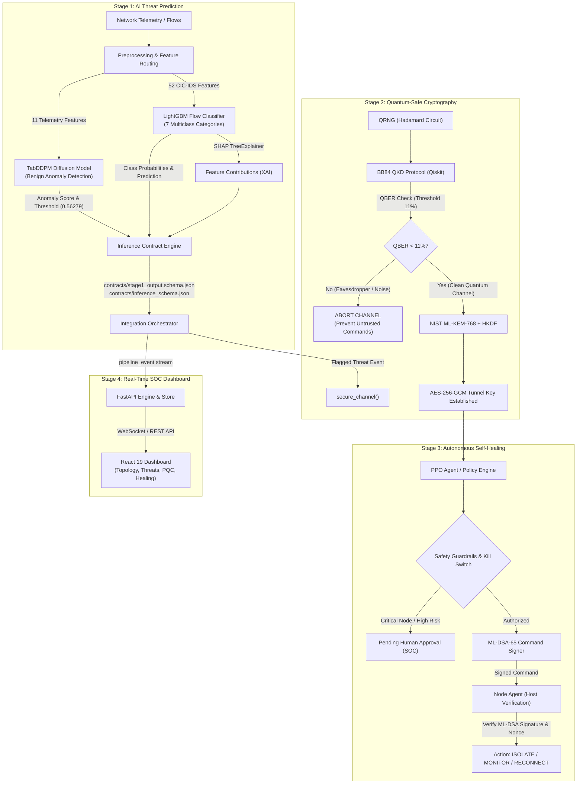

# QuantumShield AI

> **Autonomous Post-Quantum Cybersecurity & Self-Healing Network Defense Platform**

[](https://www.python.org/)
[](https://pytorch.org/)
[](https://lightgbm.readthedocs.io/)
[](https://qiskit.org/)
[](https://csrc.nist.gov/pqc)
[](https://react.dev/)
[](https://fastapi.tiangolo.com/)
[](#testing--verification)

---

## Executive Summary

**QuantumShield AI** is an enterprise-grade cybersecurity platform engineered to protect critical infrastructure against modern network intrusion and future quantum adversaries (e.g., *"Harvest Now, Decrypt Later"* threats). 

The platform unites four tightly coordinated defense stages into a single autonomous loop:
1. **Stage 1 (AI Threat Prediction)**: Dual-engine AI combining a **TabDDPM Denoising Diffusion Probabilistic Model** for benign-distribution anomaly detection and a **LightGBM Multiclass Classifier** for supervised attack categorization with **SHAP TreeExplainer** attribution.
2. **Stage 2 (Quantum-Safe Cryptography)**: Quantum Key Distribution (**BB84 protocol** simulated in Qiskit with Quantum Bit Error Rate monitoring), Quantum Random Number Generation (**QRNG**), NIST-standardized Post-Quantum Cryptography (**FIPS 203 ML-KEM-768** and **FIPS 204 ML-DSA-65**), and hybrid **AES-256-GCM** secure tunneling.
3. **Stage 3 (Autonomous Self-Healing)**: Reinforcement Learning (**Proximal Policy Optimization - PPO**) policy paired with strict multi-tier safety guardrails, human-in-the-loop approvals for critical assets, and cryptographically verified node-level remediation commands.
4. **Stage 4 (SOC Command Center)**: Real-time **FastAPI** backend streaming over WebSockets into a **React 19** dashboard providing live network topology, threat analytics, quantum channel metrics, and interactive attack simulations.

---

## Architecture & Autonomous Data Flow



---

## Stage Deep Dive

### Stage 1: AI Threat Prediction

Stage 1 operates under an explicit model registry policy where anomaly scores and classification probabilities represent distinct risk dimensions:

* **TabDDPM Anomaly Detection** ([stage1/tabddpm.py](file:///Users/anmoldineshpandey/Downloads/quantumshield-ai-main/stage1_ai_threat_prediction/stage1/tabddpm.py)):
  - **Model**: Denoising Diffusion Probabilistic Model (DDPM) implemented in PyTorch.
  - **Objective**: Models benign network distribution. Deviations produce elevated reverse-diffusion reconstruction errors.
  - **Inputs (11 Features)**: `e2c_total_bytes`, `e4_entropy_h`, `e5_entropy_c`, `e6_time_char`, `e6b_flow_duration_ms`, `e2_client_size`, `e2_client_record_len`, `e2_server_record_len`, `e1_alg_suite_mlkem1024`, `e1_alg_suite_mlkem768`, `e1_alg_suite_x25519`.
  - **Decision Threshold**: `0.56279456615448` (`score_timesteps=8`, seed `142`).
  - **Zero-Day Detection**: If network traffic appears unclassified by signature models but triggers TabDDPM anomaly threshold, it is flagged as `ANOMALY_UNKNOWN`.

* **LightGBM Multiclass Classification** ([stage1/classifier.py](file:///Users/anmoldineshpandey/Downloads/quantumshield-ai-main/stage1_ai_threat_prediction/stage1/classifier.py)):
  - **Model**: LightGBM gradient boosted tree classifier.
  - **Inputs (52 Features)**: Standardized CIC-IDS2017 flow metrics (packet lengths, flow duration, inter-arrival times, flag ratios, TCP window parameters).
  - **Classes (7)**: `Normal Traffic` (0), `DoS` (1), `DDoS` (2), `Port Scanning` (3), `Brute Force` (4), `Web Attacks` (5), `Bots` (6).
  - **Performance**: Test Macro-F1 score **> 0.93** across all classes.

* **Explainable AI (XAI)** ([stage1/explain.py](file:///Users/anmoldineshpandey/Downloads/quantumshield-ai-main/stage1_ai_threat_prediction/stage1/explain.py)):
  - Uses `shap.TreeExplainer` on raw LightGBM tree margins to generate exact per-feature contributions, translating mathematical attributions into human-readable SOC explanations (e.g., *"spike in SYN flag ratio"*, *"unusual packet rate"*).

* **Inference Response Contract** ([contracts/inference_schema.json](file:///Users/anmoldineshpandey/Downloads/quantumshield-ai-main/contracts/inference_schema.json)):
  ```json
  {
    "event_id": "evt_9aed333dd04f",
    "timestamp_utc": "2026-11-18T07:23:42.967285+00:00",
    "tabddpm": {
      "anomaly_score": 0.77554,
      "threshold": 0.56279,
      "is_anomaly": true
    },
    "lightgbm": {
      "predicted_class": "Brute Force",
      "predicted_class_id": 4,
      "class_probabilities": { "Normal Traffic": 0.157, "Brute Force": 0.841, ... }
    },
    "explainability": {
      "method": "shap.TreeExplainer",
      "top_contributing_features": [
        { "feature": "PSH Flag Count", "shap_value": 9.959, "impact": "positive", "phrase": "spike in PSH flag count" }
      ]
    },
    "risk_assessment": { "risk_level": "critical", "policy_version": "1.0" },
    "response": { "recommended_action": "isolate", "execution_status": "pending_approval" }
  }
  ```

---

### Stage 2: Quantum-Safe Cryptography

Stage 2 ensures that remediation channels and control commands cannot be intercepted, decrypted, forged, or replayed by an adversary—even one equipped with a cryptographically relevant quantum computer.

* **Quantum Random Number Generation (QRNG)** ([stage2/qrng.py](file:///Users/anmoldineshpandey/Downloads/quantumshield-ai-main/stage2_quantum_cryptography/stage2/qrng.py)):
  - Qiskit quantum circuit applying Hadamard gates ($H$) to initialized qubits ($|0\rangle \to \frac{|0\rangle + |1\rangle}{\sqrt{2}}$), measured to extract genuine quantum entropy for seeding post-quantum algorithms.

* **BB84 Quantum Key Distribution** ([stage2/bb84.py](file:///Users/anmoldineshpandey/Downloads/quantumshield-ai-main/stage2_quantum_cryptography/stage2/bb84.py)):
  - Simulates polarized photon exchange across Rectilinear ($+$) and Diagonal ($\times$) bases.
  - Sifts bases and computes the **Quantum Bit Error Rate (QBER)**.
  - **Threshold Policy**: If $\text{QBER} \ge 11\%$, eavesdropping (Eve) or severe channel disturbance is detected; the pipeline **aborts immediately** and refuses to issue commands across an untrusted channel.

* **NIST Post-Quantum Cryptography** ([stage2/pqc.py](file:///Users/anmoldineshpandey/Downloads/quantumshield-ai-main/stage2_quantum_cryptography/stage2/pqc.py)):
  - **Key Encapsulation Mechanism (KEM)**: NIST **FIPS 203 ML-KEM-768** (Kyber), combined with BB84 sifted entropy via HKDF-SHA256 to derive symmetrical AES-256-GCM session keys.
  - **Digital Signatures**: NIST **FIPS 204 ML-DSA-65** (Dilithium) for unforgeable remediation commands.

* **Command Authentication & Replay Defense** ([stage2/commands.py](file:///Users/anmoldineshpandey/Downloads/quantumshield-ai-main/stage2_quantum_cryptography/stage2/commands.py)):
  - Commands include monotonic nonces, expiration timestamps, target node IDs, and permitted action allowlists signed with the orchestrator's private ML-DSA key.

---

### Stage 3: Autonomous Self-Healing

Stage 3 transforms threat detections into safe, proportional network actions without causing self-inflicted denial-of-service.

* **PPO Reinforcement Learning Agent** ([stage3/ppo.py](file:///Users/anmoldineshpandey/Downloads/quantumshield-ai-main/stage3_self_healing/stage3/ppo.py)):
  - Custom Actor-Critic network with Generalized Advantage Estimation (GAE) and action masking.
  - Proposes actions: `isolate` (quarantine host), `monitor` (deep packet inspection), or `reconnect` (restore host after remediation and rekeying).

* **Multi-Tier Safety Guardrails** ([stage3/guardrails.py](file:///Users/anmoldineshpandey/Downloads/quantumshield-ai-main/stage3_self_healing/stage3/guardrails.py)):
  - **Action Allowlists**: Enforces strictly defined transitions.
  - **Quarantine Ceiling**: Prevents isolating more than a maximum fraction (e.g. 50%) of the fleet simultaneously.
  - **Critical Asset Protection**: Flagged critical nodes (e.g., domain controllers, database clusters) automatically switch to `pending_human_approval`.
  - **Kill Switch & Rate Limiting**: Global emergency freeze prevents cascading loops.

* **Node-Side Verification** ([stage3/node_agent.py](file:///Users/anmoldineshpandey/Downloads/quantumshield-ai-main/stage3_self_healing/stage3/node_agent.py)):
  - Hosts run a daemon verifying the ML-DSA signature against the orchestrator's public key before altering iptables/VLAN rules. Forged, replayed, or expired commands are discarded.

---

### Stage 4: SOC Dashboard & Backend Architecture

* **Backend Engine** ([backend_dashboard/app/](file:///Users/anmoldineshpandey/Downloads/quantumshield-ai-main/backend_dashboard/app/)):
  - **FastAPI** application wrapping the integration orchestrator.
  - Persistent SQLite event log and auditing store.
  - Bi-directional **WebSocket** broadcast `/ws` providing sub-second updates to clients.
  - Full REST API with OpenAPI documentation at `/docs`.

* **Frontend Command Center** ([frontend/src/](file:///Users/anmoldineshpandey/Downloads/quantumshield-ai-main/frontend/src/)):
  - Built with **React 19**, **TanStack Start**, **Tailwind CSS**, **Framer Motion**, and **Recharts**.
  - **8 Specialized SOC Views**:
    1. `/`: Real-time Overview Dashboard with threat counters and health gauges.
    2. `/threats`: AI Threat Prediction feed with SHAP feature breakdowns.
    3. `/cryptography`: Quantum key distribution metrics (QBER, sifting, PQC handshake times).
    4. `/self-healing`: Fleet status, active quarantines, and pending human approvals.
    5. `/topology`: Interactive network topology map with node infection statuses.
    6. `/pipeline`: Full end-to-end execution trace for every security event.
    7. `/simulation`: Attack injection console (DDoS, DoS, PortScan, BruteForce, Eavesdropping).
    8. `/settings`: Guardrail thresholds, PQC parameters, and API configuration.

---

## Contract-Driven System Interfaces

QuantumShield AI enforces rigorous cross-stage stability using JSON Schema contracts located in [contracts/](file:///Users/anmoldineshpandey/Downloads/quantumshield-ai-main/contracts/):

| Contract | Producer | Consumer | Schema File |
|---|---|---|---|
| `stage1_output` | Stage 1 (Threat Predictor) | Stage 2, Stage 3, Orchestrator | [stage1_output.schema.json](file:///Users/anmoldineshpandey/Downloads/quantumshield-ai-main/contracts/stage1_output.schema.json) |
| `inference_schema` | Stage 1 (TabDDPM + LightGBM) | Enterprise SOC, SIEM, Metrics | [inference_schema.json](file:///Users/anmoldineshpandey/Downloads/quantumshield-ai-main/contracts/inference_schema.json) |
| `stage2_output` | Stage 2 (Quantum Cryptography) | Stage 3, Orchestrator | [stage2_output.schema.json](file:///Users/anmoldineshpandey/Downloads/quantumshield-ai-main/contracts/stage2_output.schema.json) |
| `stage3_command` | Stage 3 (Self-Healing Signer) | Fleet Nodes, Orchestrator | [stage3_command.schema.json](file:///Users/anmoldineshpandey/Downloads/quantumshield-ai-main/contracts/stage3_command.schema.json) |
| `pipeline_event` | Integration Orchestrator | Stage 4 Backend & Dashboard | [pipeline_event.schema.json](file:///Users/anmoldineshpandey/Downloads/quantumshield-ai-main/contracts/pipeline_event.schema.json) |

---

## Repository Directory Structure

```
quantumshield-ai/
├── contracts/                        # JSON Schemas governing inter-stage data contracts
│   ├── inference_schema.json         # TabDDPM & LightGBM unified inference contract
│   ├── stage1_output.schema.json     # Threat label, confidence, risk score, explanations
│   ├── stage2_output.schema.json     # BB84 QBER, ML-KEM key IDs, handshake latencies
│   ├── stage3_command.schema.json    # ML-DSA signed commands, nonces, actions
│   └── pipeline_event.schema.json    # End-to-end event broadcast to dashboard
│
├── models/                           # Registered model manifests and binary artifacts
│   ├── quantumshield_model_registry.json
│   ├── tabddpm/improved/             # TabDDPM checkpoint (.pt) + preprocessor (.joblib)
│   └── cicids_classifier/            # LightGBM model (.txt) + bundle (.joblib)
│
├── stage1_ai_threat_prediction/      # STAGE 1: AI Threat Prediction
│   ├── stage1/
│   │   ├── tabddpm.py                # TabDDPM PyTorch diffusion anomaly detector
│   │   ├── classifier.py             # LightGBM 52-feature multiclass classifier
│   │   ├── explain.py                # SHAP TreeExplainer feature attribution
│   │   ├── predictor.py              # ThreatPredictor coordinating inference contracts
│   │   ├── preprocess.py             # Feature cleaning & scaling pipelines
│   │   ├── data.py                   # CIC-IDS2017 & synthetic flow data generators
│   │   └── train.py                  # End-to-end model training entrypoint
│   └── tests/                        # 12 automated unit tests
│
├── stage2_quantum_cryptography/      # STAGE 2: Quantum-Safe Cryptography
│   ├── stage2/
│   │   ├── qrng.py                   # Quantum Random Number Generator (Qiskit circuit)
│   │   ├── bb84.py                   # BB84 QKD protocol & QBER eavesdropper detection
│   │   ├── pqc.py                    # NIST FIPS 203 ML-KEM & FIPS 204 ML-DSA
│   │   ├── channel.py                # Hybrid HKDF & AES-256-GCM authenticated cipher
│   │   ├── commands.py               # Cryptographic command signing & verification
│   │   └── pipeline.py               # secure_channel() pipeline orchestrator
│   └── tests/                        # 25 automated unit tests
│
├── stage3_self_healing/              # STAGE 3: Autonomous Self-Healing
│   ├── stage3/
│   │   ├── ppo.py                    # Custom Actor-Critic PPO reinforcement learning
│   │   ├── env.py                    # Network infection simulation environment
│   │   ├── guardrails.py             # Rate limiters, kill switch & human approval
│   │   ├── policy.py                 # Live orchestrator policy adapter
│   │   └── node_agent.py             # Host agent verifying ML-DSA signatures
│   └── tests/                        # 10 automated unit tests
│
├── backend_dashboard/                # STAGE 4: Backend API & WebSocket Server
│   ├── app/
│   │   ├── main.py                   # FastAPI REST routes & WebSocket endpoint
│   │   ├── engine.py                 # Simulation engine, pipeline dispatcher
│   │   ├── adapter.py                # Format transformer for frontend components
│   │   ├── store.py                  # SQLite event persistence
│   │   └── simulator.py              # Synthetic background traffic injection
│   └── tests/                        # 24 automated unit tests
│
├── frontend/                         # STAGE 4: React 19 SOC Dashboard
│   ├── src/
│   │   ├── routes/                   # TanStack Start file-based pages (8 views)
│   │   ├── components/               # UI components, meters, topology canvas
│   │   └── services/                 # WebSocket client & API fetchers
│   └── package.json
│
├── integration/                      # End-to-End Integration Orchestrator
│   ├── orchestrator.py               # Coordinates Stages 1 -> 2 -> 3 -> 4
│   └── tests/                        # 11 automated integration tests
│
├── docs/                             # Engineering runbooks, architecture guides
└── requirements-integration.txt      # Comprehensive root Python dependencies
```

---

## Installation & Setup

### Prerequisites
- **Python**: Version `3.10`, `3.11`, or `3.12`
- **Node.js**: Version `20+` (or [Bun](https://bun.sh/) `1.1+`)
- **Operating System**: macOS, Linux, or Windows (WSL recommended)

### 1. Environment Setup

```bash
# Clone repository
git clone https://github.com/your-org/quantumshield-ai.git
cd quantumshield-ai

# Create and activate virtual environment
python3 -m venv venv
source venv/bin/activate       # On Windows: .\venv\Scripts\Activate.ps1

# Install all backend requirements across all stages
pip install -r requirements-integration.txt
```

### 2. Model Training & Preparation

Train the Stage 1 (TabDDPM + LightGBM) and Stage 3 (PPO) models on synthetic data (takes ~2 minutes on standard CPU):

```bash
# Train Stage 1 (generates models/ and artifacts/)
python -m stage1.train --data synthetic

# Train Stage 3 (reinforcement learning self-healing policy)
python -m stage3.train
```

---

## Testing & Verification

QuantumShield AI maintains **82 automated tests** across all subsystems, ensuring 100% contract compliance and numerical stability:

```bash
# Run all tests across the entire repository
bash scripts/run_all_tests.sh
```

Or run test suites by stage:

| Target | Command | Test Count | Scope |
|---|---|:---:|---|
| **Stage 1** | `cd stage1_ai_threat_prediction && pytest` | **12 Passed** | TabDDPM, LightGBM, SHAP, Contracts |
| **Stage 2** | `cd stage2_quantum_cryptography && pytest` | **25 Passed** | QRNG, BB84, ML-KEM, ML-DSA, Channel |
| **Stage 3** | `cd stage3_self_healing && pytest` | **10 Passed** | PPO, Guardrails, Policy, Node Agent |
| **Stage 4** | `cd backend_dashboard && pytest` | **24 Passed** | FastAPI endpoints, WebSocket, Store |
| **Integration** | `pytest integration/tests/` | **11 Passed** | End-to-end pipeline & lifecycle |
| **Total** | | **82 Passed** | **Zero Failures** |

---

## Running the Platform

### 1. Start Backend API & Engine
In your virtual environment terminal:

```bash
cd backend_dashboard
uvicorn app.main:app --host 0.0.0.0 --port 8000 --reload
```
- **Interactive OpenAPI Documentation**: [http://localhost:8000/docs](http://localhost:8000/docs)
- **Built-in HTML Dashboard**: [http://localhost:8000/](http://localhost:8000/)
- **Live WebSocket Endpoint**: `ws://localhost:8000/ws`

### 2. Start Frontend SOC Dashboard
In a separate terminal:

```bash
cd frontend
cp .env.example .env
# Set VITE_USE_MOCK_DATA=false in .env to connect to the live backend
npm install
npm run dev
```
Open [http://localhost:8080](http://localhost:8080) (or the port displayed in your terminal).

---

## Live Attack Demonstration

To observe the full autonomous protection and healing cycle:

1. Open the **Simulation Center** (`/simulation`) on the Dashboard or execute the CLI demo:
   ```bash
   PYTHONPATH=stage1_ai_threat_prediction python -m stage1.demo
   ```
2. Trigger an attack scenario (e.g., **DDoS Attack** or **Brute Force**):
   - **Detection**: Stage 1 LightGBM flags the malicious flow with high confidence; TabDDPM registers an anomaly score exceeding `0.56279`; SHAP isolates the top contributing features.
   - **Quantum Handshake**: Stage 2 initiates a `secure_channel()`. QRNG-derived photons exchange across BB84 bases. If an eavesdropper intercepts, $\text{QBER} \approx 25\%$ triggers an immediate channel shutdown.
   - **Remediation**: If the channel is verified, Stage 3's PPO policy issues an `isolate` action signed with **ML-DSA-65**.
   - **Actuation**: The target host validates the signature and isolates itself from the VLAN.
   - **Recovery**: Once the threat clears, the host is transitioned to `reconnect`, re-keyed with a fresh PQC session key, and restored to service.

---

## Scientific Principles & Integration Policies

1. **Anomaly Scores $\ne$ Probabilities**: The TabDDPM score represents a sample's reconstruction distance from the learned manifold of benign network telemetry. It is calibrated against a threshold (`0.56279456615448`), not an empirical probability.
2. **Classification Confidence $\ne$ Operational Risk**: High classifier confidence in an attack class does not alone dictate destructive network isolation; risk scoring factors host criticality, anomaly severity, and connection context.
3. **SHAP Attributions $\ne$ Causal Proof**: SHAP values quantify feature contributions to the model's raw output margin, providing operational interpretability rather than deterministic causality.
4. **Never Act Over an Untrusted Channel**: If quantum key agreement detects channel eavesdropping ($\text{QBER} \ge 11\%$) or an invalid signature, the orchestrator refuses to emit remediation commands, preventing adversarial takeover.

---

## License

This project is licensed under the Apache 2.0 License. See the [LICENSE](file:///Users/anmoldineshpandey/Downloads/quantumshield-ai-main/LICENSE) file for details.
