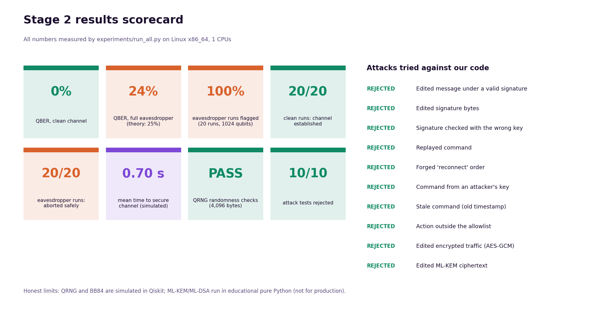

# QuantumShield AI: Stage 2 (Quantum-Safe Cryptography)

QRNG, BB84 quantum key distribution (simulated in Qiskit), ML-KEM-768 and ML-DSA-65 (NIST FIPS 203 and 204), hybrid AES-256-GCM encryption, and signed commands for the self-healing stage.



## Start here
**Follow `docs/STAGE2_MASTER_GUIDE.md`.** It takes you from zero to this finished project: research, learning, building every file, tests, results, the Jarvis-style display, and GitHub, one command at a time.

## Jarvis-style attack-and-heal display
```bash
python -m visualization.build_jarvis      # runs the real Stage 2 code, writes results/jarvis_dashboard.html
```
Double-click `results/jarvis_dashboard.html`. Five scenarios (DDoS and self-heal, eavesdropper, forged command, replay/stale/forbidden, tampered data) show how attacks break things and how the system heals. Numbers come from real runs; the Stage 1 detection step is a stand-in.

## Quick start (if you just want to run it)
```bash
python3 -m venv venv                  # Windows: python -m venv venv
source venv/bin/activate              # Windows PowerShell: .\venv\Scripts\Activate.ps1
pip install -r requirements.txt
python -m pytest -q                   # 25 passed
python -m stage2.demo                 # clean run, eavesdropper run, signed commands
python -m experiments.run_all         # all figures + results/RESULTS.md (5-8 min); add --quick for 30 s
```

## What is inside
| Path | Purpose |
|---|---|
| `stage2/qrng.py` | QRNG circuit (H + measure), batched |
| `stage2/bb84.py` | BB84 with optional intercept-resend eavesdropper and honest noise |
| `stage2/pqc.py` | ML-KEM-768 and ML-DSA-65, seeded from QRNG |
| `stage2/channel.py` | Hybrid HKDF key + AES-256-GCM |
| `stage2/commands.py` | ML-DSA signed commands: forgery, replay, stale and allowlist checks |
| `stage2/pipeline.py` | `secure_channel()`: the Stage 2 function for the backend |
| `experiments/run_all.py` | Experiments, figures, CSV, `RESULTS.md` |
| `visualization/` | Builds the Jarvis-style display from real runs |
| `tests/` | 25 automated tests |
| `exercises/` | Three predict-then-run learning exercises |
| `docs/` | Step-by-step VS Code guide, learning plan, GitHub setup |
| `results/` | Figures, CSV data, `summary.json`, `RESULTS.md` |

## Interface for the other stages
```python
from stage2.pipeline import secure_channel
result = secure_channel("192.168.1.14", stage1_output)   # status, qber, key_gen_time_ms, sizes, ...
from stage2.commands import CommandSigner, CommandVerifier  # for Stage 3
```

## Reference results (one full run, Linux x86_64, Python 3.12; yours will differ)
- QBER: 0% on a clean channel, 24% with a full eavesdropper (theory 25%); 20/20 eavesdropper runs flagged.
- 20/20 clean runs established a channel; 20/20 eavesdropper runs aborted before any key was used.
- 10/10 attack tests rejected (edited message, edited signature, wrong key, replay, forged order, attacker key, stale command, disallowed action, edited AES-GCM data, edited ML-KEM ciphertext).
- Sizes: ML-KEM-768 public key 1,184 B and ciphertext 1,088 B; ML-DSA-65 public key 1,952 B and signature 3,309 B.

## Honest limits
- QRNG and BB84 are **simulated**. The simulator's randomness is pseudo-random; this demonstrates circuits and workflow only.
- ML-KEM and ML-DSA use pure-Python educational libraries (`kyber-py`, `dilithium-py`): not constant-time, not for production. Use liboqs or OpenSSL 3.5+ for real systems. Timings here are not comparable with C code; compare sizes.
- BB84 has no error-correction step; keys that differ cause an abort.
- The randomness checks are basic sanity checks, not the full NIST SP 800-22 suite.

## References
Bennett and Brassard (1984), BB84. Shor and Preskill (2000), BB84 security. NIST FIPS 203 and FIPS 204 (2024). Stebila and Mosca (2016), Open Quantum Safe.
