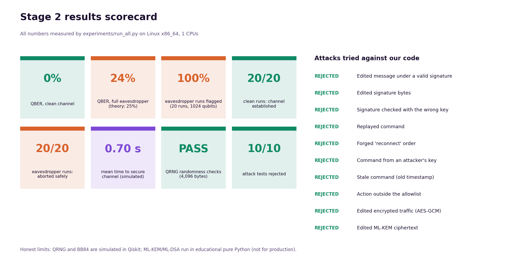
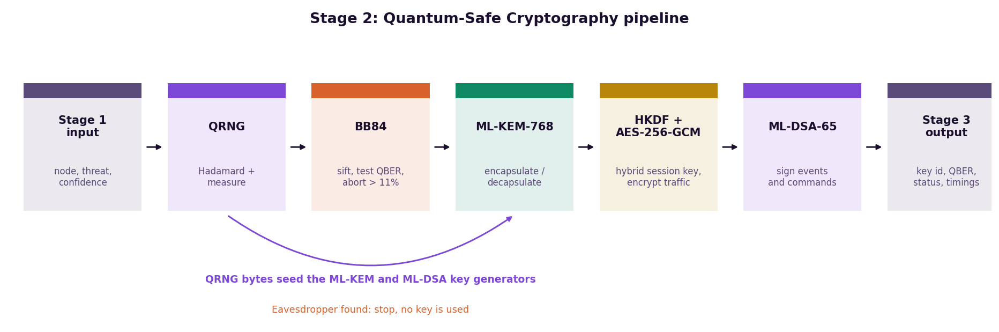
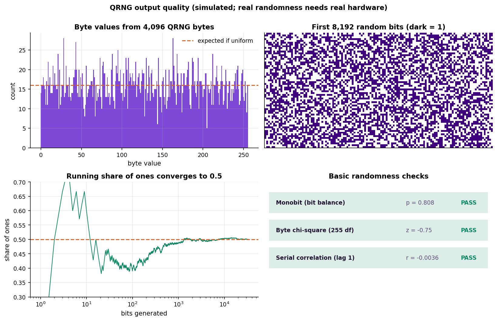
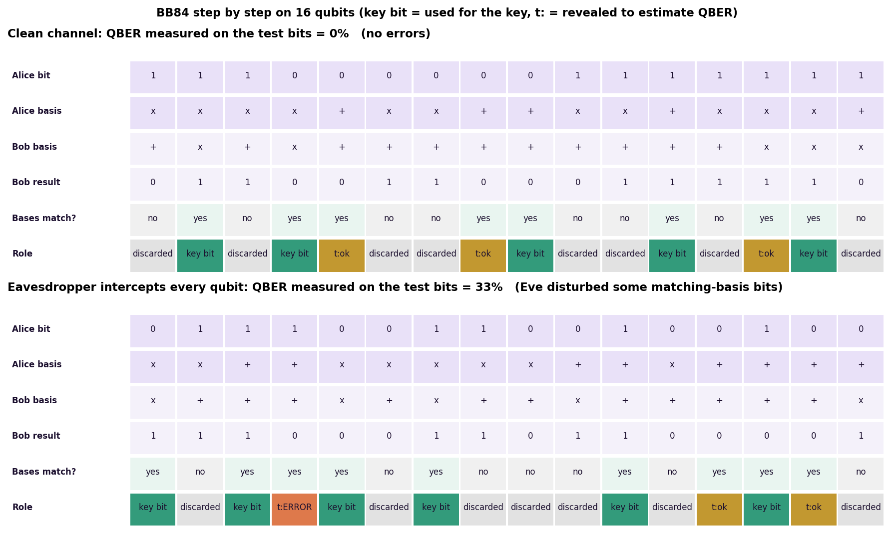
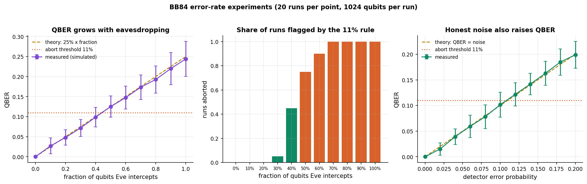
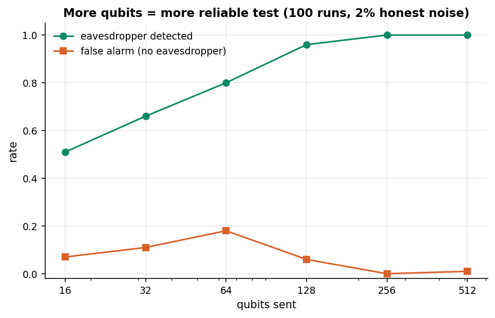
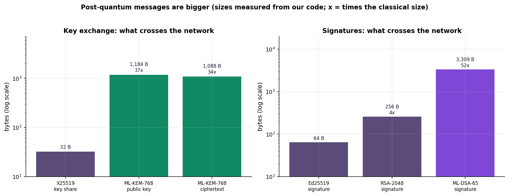
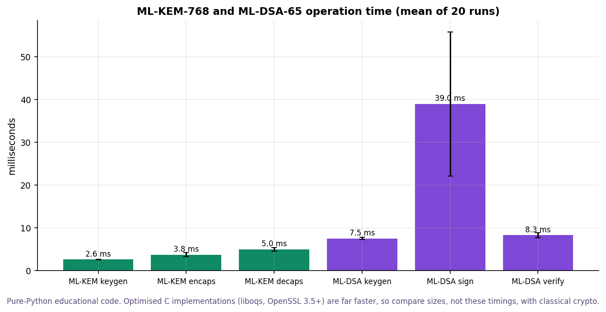
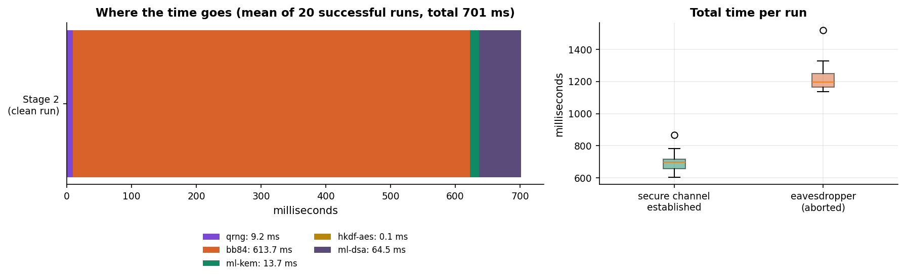

# Stage 2 Results

Generated by `python -m experiments.run_all` (full mode). Machine: Linux x86_64, 1 CPUs, Python 3.12.3, Qiskit 2.6.1.

## 1. Architecture

## 2. QRNG quality (simulated)

Monobit p = 0.808, chi-square z = -0.753, serial correlation r = -0.00363. These are basic sanity checks, not the full NIST SP 800-22 suite.
The simulator's randomness is pseudo-random; this demonstrates the circuit and workflow only.

## 3. BB84

| Measurement | Value |
|---|---|
| Mean QBER, clean channel | 0.0000 |
| Mean QBER, Eve intercepts every qubit | 0.2441 (theory 0.25) |
| Eavesdropper runs flagged (full interception) | 100% |

Reading the charts: a partial eavesdropper who touches less than about 44% of the qubits stays under the 11% limit (0.25 x 0.44 = 0.11), so the threshold alone does not catch her. In our pipeline such a run still aborts, because the two keys no longer match (we do not implement error correction).

## 4. Post-quantum sizes and speed

Sizes are exact. Timings are from pure-Python educational code and are NOT comparable with C implementations.

| Item | Bytes |
|---|---|
| X25519 key share | 32 |
| ML-KEM-768 public key | 1,184 |
| ML-KEM-768 ciphertext | 1,088 |
| ML-KEM-768 secret key | 2,400 |
| Ed25519 public key | 32 |
| Ed25519 signature | 64 |
| RSA-2048 public key (DER) | 294 |
| RSA-2048 signature | 256 |
| ML-DSA-65 public key | 1,952 |
| ML-DSA-65 secret key | 4,032 |
| ML-DSA-65 signature | 3,309 |

## 5. End-to-end pipeline

Mean phase times (ms): {'qrng_ms': 9.2, 'bb84_ms': 613.7, 'ml_kem_ms': 13.7, 'hkdf_aes_ms': 0.1, 'ml_dsa_ms': 64.5}.

## 6. Attack tests
| Attack | Result |
|---|---|
| Edited message under a valid signature | rejected |
| Edited signature bytes | rejected |
| Signature checked with the wrong key | rejected |
| Replayed command | rejected |
| Forged 'reconnect' order | rejected |
| Command from an attacker's key | rejected |
| Stale command (old timestamp) | rejected |
| Action outside the allowlist | rejected |
| Edited encrypted traffic (AES-GCM) | rejected |
| Edited ML-KEM ciphertext | rejected |
